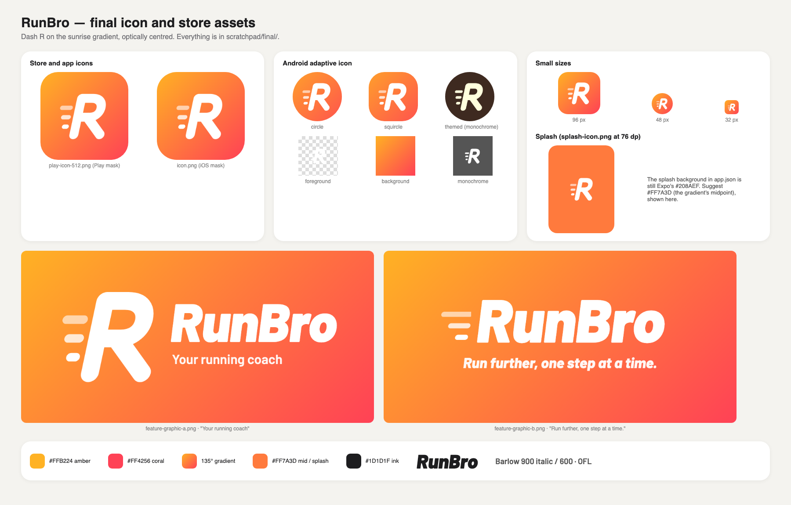

# RunBro brand

The **Dash R** mark: a white italic R with three speed dashes on a sunrise gradient
(amber `#FFB224` → coral `#FF4256`, 135°). Chosen on 2026-10-17 over five other
concepts. It is about running and the RunBro name, not about Couch to 5K, because
the plan is only the first of many the app will carry.

**Status:** designed, not yet in the app. The app still ships Expo's template icon
and splash, and its colours do not follow this palette yet. The work to change that
is tracked in the [roadmap](../roadmap/README.md).

## Files

| File                                                          | Use                                                                                                                       |
| ------------------------------------------------------------- | ------------------------------------------------------------------------------------------------------------------------- |
| `source/*.svg`                                                | Masters for every icon export (1024 canvas)                                                                               |
| `exports/play-icon-512.png`                                   | Google Play listing icon (512 × 512, full bleed; Play applies the mask)                                                   |
| `exports/icon.png`                                            | iOS / universal icon (1024, opaque)                                                                                       |
| `exports/android-icon-{foreground,background,monochrome}.png` | Android adaptive icon layers; the foreground stays inside the 66% safe zone, and the monochrome layer is for themed icons |
| `exports/splash-icon.png`                                     | White mark for the splash screen, sized for `app.json`'s 76 dp `imageWidth`, on `#FF7A3D`                                 |
| `exports/feature-graphic-{a,b}.png`                           | Google Play feature graphic candidates (1024 × 500)                                                                       |
| `brand.json`                                                  | Colour tokens, font and mark construction                                                                                 |

The type is **Barlow** (SIL Open Font License, from Google Fonts): 900 italic for
the wordmark, 800 italic for taglines, 600 for body text. It is for marketing art
only; the app keeps the system fonts.

## Open questions for the palette

The app's colours have to follow this mark before the store screenshots are taken.
These are the questions the palette has to answer:

- **Where the brand shows.** Which surfaces carry the orange and coral (buttons,
  the active tab, the run screen, charts), and which stay calm system colours.
- **Android.** The app now takes its Material You colours from the wallpaper
  (ADR 0025). Should it use brand colours instead, or keep wallpaper colours as an
  option?
- **Run, walk and warm-up colours.** Warm-up is already orange and run is system
  blue, so the segment colours (`useSegmentColors`, the pace chart, the interval
  bar) need a new mapping that doesn't clash with the brand.
- **Contrast.** White on `#FF7A3D` is about 2.6:1 (1.8:1 on the amber end, 3.4:1 on the coral end), below the 4.5:1 WCAG AA asks of
  body text. Text and controls need a darker shade of the brand, while the bright
  gradient stays decorative.
- **Dark mode** on both platforms.

To re-export an icon, render its SVG at the target size, for example with headless
Chrome:
`"/Applications/Google Chrome.app/Contents/MacOS/Google Chrome" --headless=new --window-size=1024,1024 --default-background-color=00000000 --screenshot=out.png source/icon.svg`.
